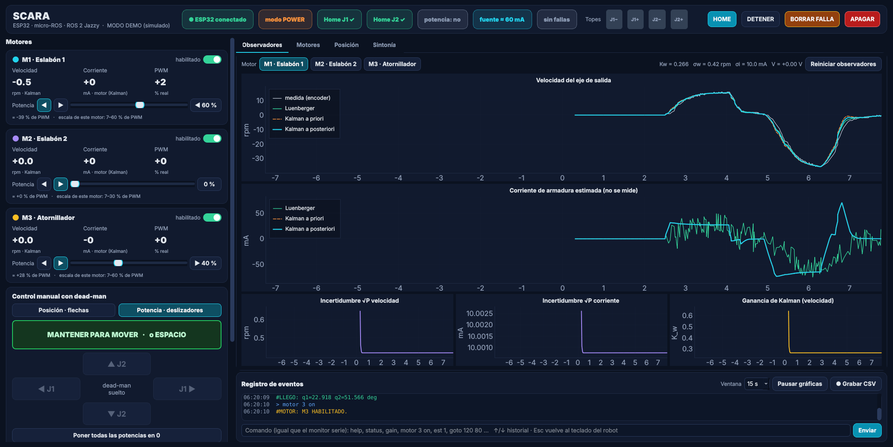
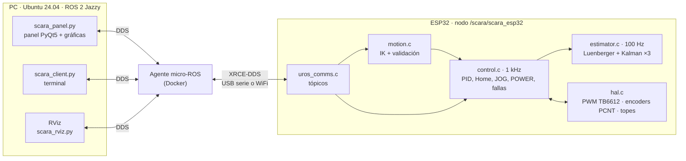
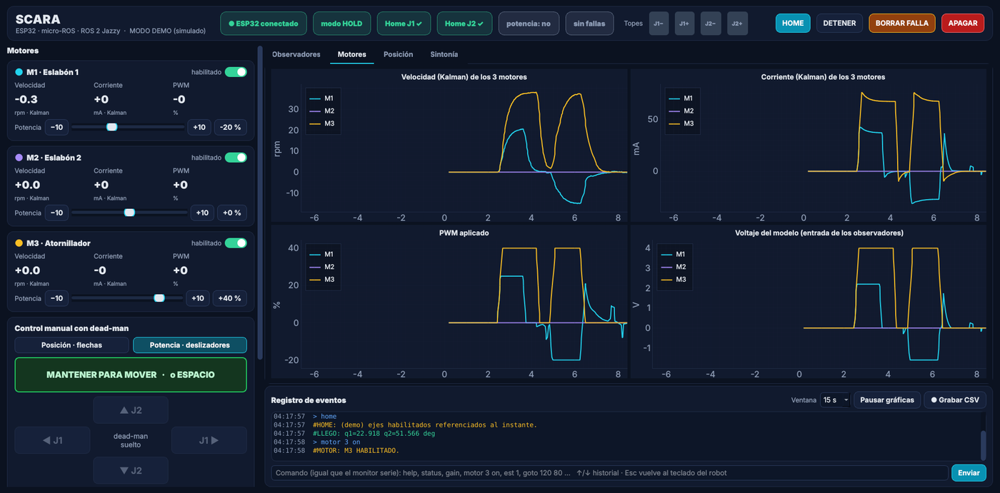
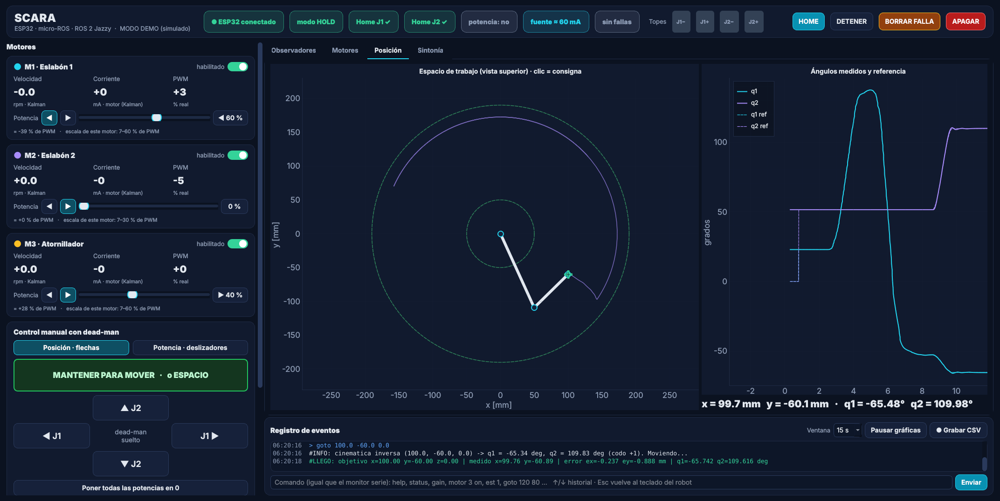
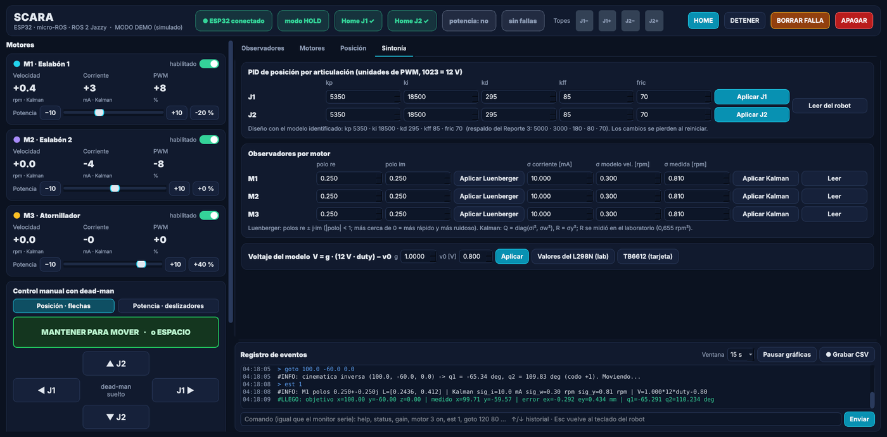

<div align="center">

# SCARA · firmware ESP32 + micro-ROS

**Robot SCARA de 2 ejes + atornillador, controlado por un ESP32 que es un nodo de ROS 2**


Juan David Botero Cubides · Ingeniería Mecatrónica · Universidad EIA



</div>

---

## Contenido

1. [Qué hace](#1-qué-hace)
2. [Arquitectura](#2-arquitectura)
3. [Inicio rápido (Ubuntu + micro-ROS)](#3-inicio-rápido-ubuntu--micro-ros)
4. [El panel de control](#4-el-panel-de-control)
5. [Motores: habilitar y potencia manual](#5-motores-habilitar-y-potencia-manual)
6. [Observadores: Luenberger y Kalman](#6-observadores-luenberger-y-kalman)
7. [Controladores PID (diseñados con el modelo identificado)](#7-controladores-pid-diseñados-con-el-modelo-identificado)
8. [Interfaz ROS 2](#8-interfaz-ros-2)
9. [Comandos](#9-comandos)
10. [Hardware y pines](#10-hardware-y-pines)
11. [Seguridad](#11-seguridad)
12. [Estructura del repositorio](#12-estructura-del-repositorio)
13. [Pruebas en el PC](#13-pruebas-en-el-pc)
14. [Estado de verificación y pendientes](#14-estado-de-verificación-y-pendientes)
15. [Anexos: cinemática, protocolo de texto, caracterización](#15-anexos)

> **Guías:** [`UBUNTU_MICROROS.md`](UBUNTU_MICROROS.md) (instalación paso a paso y fallos) ·
> [`Guia_operacion_SCARA_ROS2.pdf`](Guia_operacion_SCARA_ROS2.pdf) (cómo correr el sistema en la demostración) ·
> [`Justificacion_SCARA.pdf`](Justificacion_SCARA.pdf) (por qué se diseñó así, con preguntas y respuestas para la sustentación) ·
> [`Justificacion_Observadores_SCARA.pdf`](Justificacion_Observadores_SCARA.pdf) (solo los observadores de Luenberger y Kalman, a fondo).

---

## 1. Qué hace

| | |
|---|---|
| **Control en el ESP32** | Lazo de **1 kHz** en C: PID + prealimentación + compensación de fricción, perfil trapezoidal sincronizado, cinemática inversa, Home con finales de carrera y supervisión de fallas. |
| **ROS 2 por micro-ROS** | El ESP32 es el nodo `/scara/scara_esp32`. Consignas `(x, y, z)`, manual con dead-man, potencia manual y comandos llegan por tópicos. Funciona por USB serie o por WiFi. |
| **3 motores, cada uno se activa por separado** | M1 (eslabón 1), M2 (eslabón 2) y M3 (atornillador). Se habilitan o deshabilitan en vivo (`motor 2 off`). Un motor deshabilitado queda libre. |
| **Potencia manual** | Deslizador **0–100 %** y sentido ◀ ▶ por motor (lazo abierto), que se aplica mientras mantienes el dead-man. Cada motor tiene su propia escala (arranque y tope de PWM). Sirve para mover rápido a mano o hacer girar el atornillador. |
| **Observadores** | Luenberger y filtro de Kalman en el ESP32 para los 3 motores, a 100 Hz. Midiendo solo la velocidad del encoder, estiman **velocidad y corriente**. Usan el modelo identificado del Laboratorio 4 de Control Digital. |
| **Panel gráfico** | PyQt5 + pyqtgraph, con tema oscuro. Muestra las gráficas de los observadores, la comparación de los 3 motores, la vista XY del brazo y la sintonía en vivo. Tiene registro de eventos y grabación a CSV. Incluye un **modo demo** sin robot. |

## 2. Arquitectura



El control de bajo nivel (lazo de 1 kHz, PID, cinemática inversa, seguridad y observadores) corre **dentro del ESP32**.
ROS 2 solo envía consignas y recibe estado y estimaciones.

## 3. Inicio rápido (Ubuntu + micro-ROS)

> La instalación completa (ROS 2, Docker, PlatformIO, dependencias del componente) está en [`UBUNTU_MICROROS.md`](UBUNTU_MICROROS.md).

```bash
# 0) una sola vez: dependencias del panel
sudo apt install python3-pyqt5 python3-pyqtgraph

# 1) firmware en modo micro-ROS por USB (solo si cambiaste algo del firmware)
#    en una carpeta nueva (zip o clon), primero el componente micro-ROS, que no viene incluido:
git clone -b jazzy https://github.com/micro-ROS/micro_ros_espidf_component.git components/micro_ros_espidf_component
python3 tools/uros_select.py serial        # también deja el componente compatible con ESP-IDF 5.3
env -i HOME="$HOME" TERM="$TERM" PATH="/usr/local/sbin:/usr/local/bin:/usr/sbin:/usr/bin:/sbin:/bin:$HOME/.local/bin" \
    bash --noprofile --norc -c 'pio run -t fullclean && pio run -t upload'      # compilar SIN ROS cargado

# 2) Terminal 1 — agente micro-ROS (y luego botón EN del ESP32)
docker run -it --rm -v /dev:/dev --privileged --net=host microros/micro-ros-agent:jazzy serial --dev /dev/ttyUSB0 -b 115200

# 3) Terminal 2 — panel de control
source /opt/ros/jazzy/setup.bash
python3 ros2/scara_panel.py

# (opcional) Terminal 3 — RViz
ros2 launch ros2/scara_rviz.launch.py
```

**¿Sin robot a mano?** `python3 ros2/scara_panel.py --demo` simula el ESP32 con el modelo identificado. Muestra los mismos tópicos, los observadores y las gráficas, así que sirve para practicar la demostración.

Orden obligatorio en el robot: **Home** primero. Sin Home se rechazan `goto` y `ang`.

## 4. El panel de control

`python3 ros2/scara_panel.py` (`--demo` sin robot). Reemplaza al panel Tk anterior. `ros2/scara_teleop_ros.py` sigue en el repositorio como respaldo liviano.

| Observadores | Motores |
|---|---|
|  |  |
| **Posición** | **Sintonía** |
|  |  |

| Zona | Qué hace |
|---|---|
| **Encabezado** | Conexión con el ESP32, modo, Home J1/J2, potencia manual activa, **corriente estimada de la fuente**, falla y los 4 finales de carrera. Botones **HOME · DETENER · BORRAR FALLA · APAGAR**. |
| **Tarjetas de motor** | Interruptor para **habilitar o deshabilitar** cada motor. Velocidad y corriente estimadas (Kalman), PWM real aplicado y **deslizador de potencia de 0 a 100 %** con botones de sentido ◀ ▶. Debajo se ve el % de PWM que se envía. Clic en el valor = 0. |
| **Control manual** | Elige **Posición** (flechas → `/scara/jog`) o **Potencia** (deslizadores → `/scara/power`). El dead-man es el botón verde **MANTENER** o la barra **ESPACIO**. Los botones de flecha también funcionan manteniéndolos presionados. |
| **Mover a una consigna** | `x, y, z` en mm (con codo +1/−1) o `q1, q2` en grados. En la pestaña Posición, un **clic en el plano** elige `(x, y)`. |
| **Observadores** | Por motor: velocidad **medida / Luenberger / Kalman a priori / Kalman a posteriori**; **corriente** (Luenberger, Kalman a priori y a posteriori); incertidumbre √P de velocidad y corriente; **ganancia de Kalman**. Botón *Reiniciar observadores* para ver la convergencia. |
| **Motores** | Velocidad, corriente, PWM y voltaje del modelo de los 3 motores juntos, y la **corriente que debería marcar la fuente**. |
| **Posición** | Vista superior con el espacio de trabajo, el brazo, la estela y la consigna. Gráfica de `q` contra `q_ref`. |
| **Sintonía** | PID por eje (leer / aplicar), polos del Luenberger y σ del Kalman por motor, el mapa de voltaje `V = g·12·duty − v0` (con valores del L298N del laboratorio o del TB6612 de la tarjeta), la **escala de los deslizadores** por motor y la **corriente de la parte lógica**. |
| **Registro** | Eventos con colores, línea de comandos con historial (↑ ↓), ventana de tiempo, pausa y **Grabar CSV** (todas las estimaciones a 20 Hz). |

**Teclado** (con el foco fuera de los cuadros de texto):

| Tecla | Acción | Tecla | Acción |
|---|---|---|---|
| `ESPACIO` (mantener) | dead-man | `h` | Home |
| `←` `→` | J1 − / + | `s` · `Esc` | Detener |
| `↓` `↑` | J2 − / + | `o` | Apagar motores |
| `r` | Reiniciar observadores | `c` | Borrar falla |

Si escribes en un cuadro o la ventana pierde el foco, el teclado del robot se desactiva y el dead-man se suelta. Un clic fuera de los cuadros, o `Esc` dentro de uno, lo devuelve.

## 5. Motores: habilitar y potencia manual

**Habilitar / deshabilitar** (`motor j on|off`, `motors 1 1 0`, o el interruptor del panel):

| Motor deshabilitado… | |
|---|---|
| Driver | Queda **libre** (IN1 = IN2 = 0, PWM 0). Se puede mover a mano. |
| Encoder | **Sigue contando**: si estaba referenciado no pierde el Home. |
| Home | Solo se referencian los ejes habilitados. |
| `goto x y z` | Necesita J1 y J2 habilitados (la cinemática inversa usa los dos). |
| `ang q1 q2` | Mueve solo los ejes habilitados; el otro se queda donde está. |
| Fallas | No entra en la supervisión (seguimiento, motor trabado). |
| Al rehabilitarlo | Mantiene la posición en la que esté. |

Al arrancar están habilitados **M1 y M2**; M3 empieza deshabilitado (`MOTORES_HABILITADOS_INIT` en `config.h`).

**Potencia manual** (`/scara/power = [dead-man, %M1, %M2, %M3]` a 25 Hz):

- Solo funciona **mientras llega el dead-man**. Sin latidos durante 300 ms, todo vuelve a 0.
- Los ejes con potencia van en **lazo abierto** (con la misma rampa de PWM).
- Los ejes con 0 % **mantienen su posición** con su PID.
- Al soltar, cada eje **frena con amortiguamiento** y se queda donde paró. Después el brazo pasa a HOLD.
- **M3 (atornillador)** se mueve solo con potencia manual. Funciona en paralelo al brazo, incluso con el brazo en OFF.
- Sigue prohibido empujar contra un final de carrera presionado. Con Home hecho, no se sale de los límites por software.
- **Detener / Apagar / falla** bloquean la potencia hasta que sueltes el dead-man. Así no arranca sola otra vez.
- Tope: `DUTY_MAX` = 650/1023 ≈ 63 % de PWM.

**Escala del deslizador** (solo en el panel; por `/scara/power` sigue viajando % de PWM real):

| Deslizador | PWM enviado |
|---|---|
| 0 % | 0 (el eje mantiene su posición) |
| 1 % | *arranque*: el PWM con el que el motor apenas empieza a girar |
| 100 % | *tope* de ese motor |

Por defecto: arranque 7 % para los tres; tope 60 % (M1), **30 % (M2, eslabón 2)** y 60 % (M3). Se cambian en **Sintonía** y el panel los recuerda. Si un motor no se mueve con 1–5 %, sube su arranque; si va muy rápido al 100 %, baja su tope.

**Corriente de la fuente.** La corriente estimada en las tarjetas es la **del motor** (armadura). La fuente marca otra cosa:

```
I_fuente ≈ I_lógica + Σ |i_motor| · |duty|
```

- `I_lógica`: ESP32, reguladores, encoders y driver. Se mide en la fuente con el robot conectado y los motores **apagados** (botón APAGAR) y se escribe en Sintonía (60 mA por defecto).
- `|i_motor| · |duty|`: con PWM el motor solo toma corriente de la fuente durante el tiempo encendido. Con 0,10 A en el motor y 40 % de PWM, la fuente ve unos 40 mA.

El encabezado y la pestaña Motores muestran ese valor para compararlo con el amperímetro de la fuente.

## 6. Observadores: Luenberger y Kalman

Mismo diseño del **Laboratorio 4 de Control Digital**, llevado al ESP32 (`src/estimator.c`). Corren para los 3 motores a **100 Hz** (Ts = 10 ms), con la velocidad medida como diferencia de cuentas del encoder en 10 ms. **Solo miden la velocidad** y estiman **velocidad y corriente**.

**Modelo identificado** (referido al eje de salida, así no depende de si la caja es 100,37:1 o 102,08:1):

```
La·di/dt = V − Ra·i − Kv·ω          J·dω/dt = Kv·i − B·ω          y = ω  (C = [0 1])
```

| Parámetro | Valor | Origen |
|---|---|---|
| `Ra` · `La` | 50 Ω · 0,060 H | medidos (Lab 2) |
| `Kv` | 0,1671 V·s/rad (1,6369·10⁻³ en el eje del motor) | ajustado para 12 V → 0,2 A y 114,3 rpm |
| `B` | 2,792·10⁻³ N·m·s/rad (2,679·10⁻⁷ en el eje del motor) | idem |
| `J` | 3,632·10⁻⁴ kg·m² (3,486·10⁻⁸ en el eje del motor) | ajuste de los escalones de subida (τ ≈ 0,108 s) |
| Voltaje | `V = g·(12 V·duty) − v0` | TB6612: g = 1, v0 = 0,8 V · L298N (lab): g = 0,9782, v0 = 1,197 V |

| Observador | Diseño por defecto | Cambiar en vivo |
|---|---|---|
| **Luenberger** (predictor) `x̂(k) = A x̂(k−1) + B u(k−1) + L [y(k−1) − C x̂(k−1)]` | polos 0,25 ± 0,25j → `L = [0,2436; 0,4120]` (Ackermann) | `luen j re im` |
| **Kalman** (predicción con `u(k−1)`, corrección con `y(k)`) | σi = 10 mA, σw = 0,30 rpm, σy = 0,81 rpm (R = 0,655 rpm² del lab) → `Kw ≈ 0,266` | `kal j σi[mA] σw[rpm] σy[rpm]` |

Las matrices `A`, `B` (ZOH exacto) y `L` se calculan **en el ESP32** a partir del modelo. Los resultados son idénticos a los del MATLAB del laboratorio: la diferencia máxima sobre los datos reales del motor es de 2·10⁻⁵ rpm (`tools/host_tests/test_estimator.c`).

> **Para la discusión:** con `Ra = 50 Ω` la corriente queda casi fijada por el voltaje (la fuerza contraelectromotriz es como mucho 2 V de 12). Por eso el Kalman casi no corrige la corriente (`K_i ≈ 0`) y la corriente estimada **casi no reacciona a la carga**. Con el modelo identificado como planta, el Kalman estima la corriente con menos de 1 mA de error. Con un motor del datasheet (`Ra ≈ 2,2 Ω`) la corriente real sería mucho mayor que la estimada. Ver §14.

## 7. Controladores PID (diseñados con el modelo identificado)

Planta de posición `θ/V = K / (s (τs + 1))` con `K = 0,9974 rad/s por V` y `τ = 0,108 s`. Con PID y prealimentación `kff = 1/K`:

```
τ s³ + (1 + K·Kd) s² + K·Kp s + K·Ki = 0      polos deseados  (s² + 2·0,9·20 s + 20²)(s + 5)
→ Kp = 62,8 V/rad · Ki = 216,6 V/(rad·s) · Kd = 3,44 V·s/rad   (×1023/12 para PWM)
```

| Ganancias (PWM) | kp | ki | kd | kff | fric |
|---|---|---|---|---|---|
| **J1** — modelo identificado (por defecto) | 5350 | 18500 | 295 | 85 | 70 |
| **J2** — Reporte 3 (por defecto) | 5000 | 3000 | 180 | 80 | 70 |

Verificadas en simulación con las dos plantas (`tools/host_tests/sim_pid.c` y `sim_control.c`): en un `goto` el error es menor a 0,25 mm y no hay sobrepaso apreciable. En el robot, el eslabón 2 (liviano) quedó **muy agresivo** con las del modelo (ki 6 veces mayor), así que J2 usa las del Reporte 3, que ya estaban probadas (`GANANCIAS_J2_REPORTE3 1` en `src/config.c`). Para que J1 también use las del Reporte 3: `GANANCIAS_DEL_MODELO 0`. En vivo, sin recargar: `gain j kp ki kd kff fric` o la pestaña Sintonía. **Prueba primero con movimientos cortos.**

## 8. Interfaz ROS 2

| Tópico | Tipo | Sentido | Contenido |
|---|---|---|---|
| `/scara/goto` | `geometry_msgs/Point` | PC → ESP32 | x, y, z [mm] (z fija: `Z_FIJO_MM`) |
| `/scara/jog` | `geometry_msgs/Vector3` (best-effort) | PC → ESP32 | x = dead-man, y = dir J1, z = dir J2 (−1/0/+1), 25 Hz |
| `/scara/power` | `std_msgs/Float32MultiArray` (best-effort) | PC → ESP32 | **nuevo**: `[dead-man, %M1, %M2, %M3]`, 25 Hz |
| `/scara/cmd` | `std_msgs/String` | PC → ESP32 | comandos de texto (§9) |
| `/scara/state` | `std_msgs/Float32MultiArray` (best-effort) | ESP32 → PC | 19 números a 20 Hz (tabla abajo) |
| `/scara/obs` | `std_msgs/Float32MultiArray` (best-effort) | ESP32 → PC | **nuevo**: observadores de los 3 motores, 20 Hz |
| `/scara/ee_position` | `geometry_msgs/Point` (best-effort) | ESP32 → PC | posición medida del efector [mm] |
| `/scara/event` | `std_msgs/String` | ESP32 → PC | `#OK #INFO #HOME #LLEGO #ERROR #FALLA #MOTOR #EST` |

<details>
<summary><b>/scara/state</b> (19 datos; los 13 primeros son los de siempre)</summary>

| Pos. | Significado | Pos. | Significado |
|---|---|---|---|
| 0, 1 | q1, q2 [°] | 11, 12 | PWM de M1, M2 |
| 2, 3 | x, y [mm] | 13 | motores habilitados (bits: 1 = M1, 2 = M2, 4 = M3) |
| 4 | modo: 0 OFF · 1 HOMING · 2 HOLD · 3 MOVE · 4 JOG · 5 PULSE · 6 FAULT · **7 POWER** | 14 | PWM de M3 |
| 5 | falla (0 ninguna … 5 MIN y MAX a la vez) | 15 | potencia manual activa (dead-man) |
| 6, 7 | Home J1, J2 | 16–18 | velocidad medida de M1, M2, M3 [rpm] (filtrada, 1 kHz) |
| 8 | finales de carrera (bits: 1 J1 min, 2 J1 max, 4 J2 min, 8 J2 max) | | |
| 9, 10 | q1, q2 de referencia [°] | | |
</details>

<details>
<summary><b>/scara/obs</b> (2 + 3 × 12 = 38 datos)</summary>

`[secuencia, banderas, M1(12), M2(12), M3(12)]`. Banderas: bit m = diseño válido del motor m; bit m+3 = el motor tiene encoder.
Por motor: `vel. medida [rpm], vel. Luenberger, vel. Kalman a priori, vel. Kalman a posteriori, corriente Luenberger [A],
corriente Kalman a priori, corriente Kalman a posteriori, σ corriente [A], σ velocidad [rpm], K_w, K_i, voltaje del modelo [V]`.
El formato está en `ros2/scara_common.py` (`parse_obs`).
</details>

Ancho de banda: con todo a 20 Hz se usa ~55 % de 115200 baudios. Para gráficas más fluidas, sube a 460800 con `tools/uros_select.py serial --baud 460800` y `-b 460800` en el agente.

## 9. Comandos

Iguales por `/scara/cmd`, por la línea de comandos del panel y por el monitor serie (modo texto).

| Comando | Qué hace |
|---|---|
| `home` · `stop` · `off` · `clear` | Home · detener y mantener · apagar motores · borrar falla |
| `goto x y [z]` · `ang q1 q2` · `elbow ±1` | consigna en mm · en grados · codo preferido |
| `gain` · `gain j kp ki kd kff fric` | ver · cambiar el PID del eje j |
| `pulse j` | pulso corto para comprobar el sentido del motor j (1 o 2) |
| `motor j on\|off` · `motors` · `motors a b c` | **habilitar/deshabilitar** el motor j (1, 2, 3) · ver · los tres a la vez |
| `est [j]` · `est reset` | parámetros del observador del motor j · reiniciar observadores (x̂ = 0, P = P0) |
| `luen j re im` | polos del Luenberger (re ± j·im, \|polo\| < 1) |
| `kal j σi σw σy` | Kalman: σ corriente [mA], σ modelo de velocidad [rpm], σ medida [rpm] |
| `vmap g v0` | voltaje del modelo `V = g·12·duty − v0` |
| `status` · `help` | resumen · lista de comandos |

Por terminal: `python3 ros2/scara_client.py home | goto 120 80 0 | ang 20 90 | motor 3 on | obs | monitor | cmd "est 1"`.

## 10. Hardware y pines

ESP32-DevKitC WROOM-32 · drivers TB6612FNG (SparkFun ROB-14450) · 3 motores Pololu 37D 12 V 100:1 con encoder de 64 CPR (6424 cuentas por vuelta de salida) · finales de carrera NA a GND en J1 y J2.

| Señal | M1 (J1) | M2 (J2) | M3 (atornillador) |
|---|---|---|---|
| PWM · IN1 · IN2 | 2 · 16 · 4 | 19 · 5 · 18 | 21 · 23 · 22 |
| Encoder A · B | 33 · 25 | 26 · 27 | **32 · 14** `[CAMBIAR]` (J8) |
| Topes MIN · MAX | 36 · 39 | 34 · 35 | — |
| STBY (los 3) | 17 | | |

> **Confirma los pines del encoder 3 con el esquema de la tarjeta** (conector J8) en `src/config.h`. Si M3 no tiene encoder conectado, pon `M3_TIENE_ENCODER 0`: su observador funciona solo con el modelo.

## 11. Seguridad

- STBY = 0 al arrancar, en fallas y al reiniciar (watchdog de tareas de 2 s).
- Rampa de PWM de 0,34 s a fondo de escala; tope de PWM del 63 %.
- Dead-man con *timeout* (150 ms en texto, 300 ms en ROS 2) para JOG **y** para potencia manual. Si se cae el agente, todo se detiene.
- Prohibido empujar contra un final de carrera presionado. Límites por software con Home hecho, también en potencia manual.
- Fallas con freno de 150 ms: error de seguimiento, motor trabado, final de carrera inesperado en MOVE, tiempo de Home agotado, MIN y MAX a la vez.
- Detener, apagar o una falla bloquean la potencia manual hasta soltar el dead-man.
- Home exigido para `goto`/`ang`; `goto` rechaza una z distinta de la altura fija.

## 12. Estructura del repositorio

| Ruta | Qué es |
|---|---|
| `src/config.h`, `src/config.c` | **Todos los parámetros**: pines, motores habilitados, modelo del motor, observadores, ganancias |
| `src/control.c` | Lazo de 1 kHz: Home, MOVE, JOG, POWER, máscara de motores, supervisión, observadores |
| `src/estimator.c` | Luenberger + Kalman (C puro, probado en el PC) |
| `src/hal.c` | PWM, dirección, encoders PCNT (3) y finales de carrera |
| `src/kinematics.c`, `src/traj.c`, `src/pid.c` | Cinemática, trayectoria trapezoidal, PID |
| `src/motion.c`, `src/uros_cmd.c` | Validación + IK de consignas; intérprete de comandos (compartidos por texto y ROS 2) |
| `src/uros_comms.c`, `src/uros_serial_transport.c` | Capa micro-ROS (tópicos) y transporte serie |
| `src/comms.c` | Protocolo de texto por serial (Windows / monitor) |
| `ros2/scara_panel.py` | **Panel de control** (PyQt5 + pyqtgraph, `--demo`) |
| `ros2/scara_common.py` | Formato de tópicos, cinemática y estimador en Python |
| `ros2/scara_client.py` | Cliente de terminal |
| `ros2/scara_teleop_ros.py` | Panel Tk anterior (respaldo liviano) |
| `ros2/scara_rviz.py`, `scara_rviz.launch.py`, `scara.urdf`, `scara.rviz` | Visualización en RViz |
| `tools/uros_select.py` | Cambia entre texto / micro-ROS serial / micro-ROS WiFi |
| `tools/host_tests/` | Pruebas en el PC (`run.sh`) |
| `tools/docs/guia_operacion.py` | Genera `Guia_operacion_SCARA_ROS2.pdf` (edita ahí y vuelve a generar) |
| `docs/img/` | Capturas del panel |
| `docs/justificacion/` | Fuente LaTeX de las dos justificaciones y los scripts de sus figuras y estudios (compilar con `latexmk -xelatex`) |
| `tools/teleop.py`, `tools/characterize.py` | Teleop por serial (modo texto) y caracterización |

## 13. Pruebas en el PC

```bash
sh tools/host_tests/run.sh          # gcc + python3 (numpy)
```

| Prueba | Qué comprueba |
|---|---|
| `test_kin_traj.c` | Cinemática (4761 puntos, error FK(IK) 0,0001 mm) y trayectoria |
| `sim_pid.c` | PID de una articulación con la planta del motor |
| `sim_control.c` | **Firmware completo** con la planta de la hoja de datos (Home, goto < 0,25 mm, dead-man, límites, fallas, motores deshabilitados, potencia manual, observadores). Además, con la planta **identificada**: potencia y observadores, donde la corriente estimada coincide con la real con menos de 1 mA de error. |
| `test_estimator.c` | `A`, `B`, `L` y la ganancia de Kalman iguales a las del laboratorio; convergencia con encoder cuantizado |
| `test_uros_cmd.c`, `test_comms.c` | Intérprete de comandos (motores, observadores, vmap) y la interfaz de texto |
| `test_common.py` | Formato de `/scara/state` y `/scara/obs`, estimador en Python |
| sintaxis micro-ROS | `uros_comms.c` compila contra las firmas de `rclc`/`rmw_microxrcedds` (serial y WiFi) |

## 14. Estado de verificación y pendientes

| Parte | Estado |
|---|---|
| Lógica de control, motores habilitados, potencia manual, observadores | **Probado en simulación** (PC) |
| Observadores contra los datos reales del laboratorio | **Probado**: idénticos al MATLAB del Lab 4 |
| Panel (`scara_panel.py`) | **Probado** en modo demo y con un ROS simulado; **sin correr con ROS 2 real** |
| Compilación con ESP-IDF / micro-ROS reales | **Sin verificar en esta versión** (en el PC solo se comprobó la sintaxis con cabeceras simuladas). La versión anterior sí corrió en el robot. |
| Pines del encoder de M3 (J8) y signos de M3 | **[CAMBIAR]**: confirmar con el esquema y con un pulso de potencia |
| Ganancias PID nuevas | Diseñadas y simuladas; **probarlas en el robot** con movimientos cortos (respaldo: `GANANCIAS_DEL_MODELO 0`) |
| `vmap` en la tarjeta (TB6612) | `v0 = 0,8 V` es una estimación (equivale al `fric` del PID). Para ajustarla, compara la velocidad medida con la del modelo en la pestaña Motores. |
| `Ra = 50 Ω` | Medida con multímetro. El datasheet sugiere ~2,2 Ω (12 V / 5,5 A). Con 50 Ω la corriente estimada casi no ve la carga (§6). |

## 15. Anexos

<details>
<summary><b>Cinemática</b></summary>

`x = L1 cos q1 + L2 cos(q1+q2)`, `y = L1 sin q1 + L2 sin(q1+q2)`, con `L1 = 120 mm`, `L2 = 70 mm` (alcance de 50 a 190 mm).
`c2 = (x²+y²−L1²−L2²)/(2 L1 L2)`, `q2 = ±acos c2`, `q1 = atan2(y,x) − atan2(L2 sin q2, L1 + L2 cos q2)`.
Hay dos soluciones (codo ±): se intenta la preferida (`elbow`) y, si viola los límites, la otra. Las singularidades están en `q2 = 0` y `±180°` (`det J = L1 L2 sin q2`); se rechaza `|q2| < 5°`.
</details>

<details>
<summary><b>Protocolo de texto (Windows / monitor serie)</b></summary>

`python3 tools/uros_select.py text` y reflashear. Al arrancar muestra un menú de un toque:

| Tecla | Acción |
|---|---|
| `1` / `2` / `3` | estado / sensores en vivo / telemetría |
| `4` / `5` / `6` / `7` | pulso de prueba / Home / ir a x y z / ir a ángulos |
| `8` / `9` / `0` | detener / apagar / borrar falla |

En modo texto también funcionan todos los comandos de §9. El modo máquina (`fmt 1`, lo usa `tools/teleop.py`) acepta el latido manual `d dm a b` y el de potencia `p dm %1 %2 %3`.
</details>

<details>
<summary><b>Caracterización (Reporte 3)</b></summary>

`tools/characterize.py` hace 5 puntos × 10 repeticiones (CSV y resumen con exactitud y repetibilidad). Antes hay que decidir el método de *ground truth*: regla o papel milimetrado (`--medir`), solo encoders, o topes con ángulo conocido. Ejecutar con Home hecho y con el teleop y el monitor cerrados:
`python tools/characterize.py --port COM10 --reps 10 --medir-cada`.
</details>
