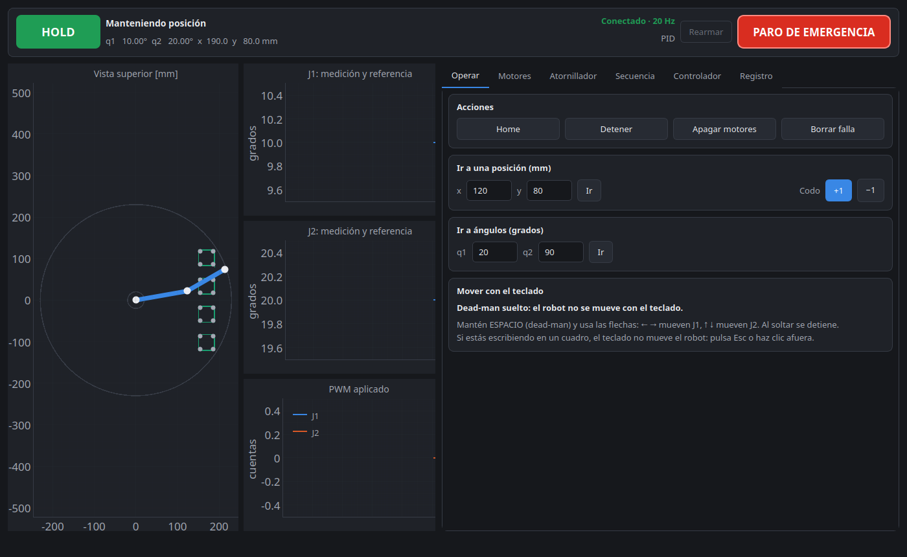

# SCARA Process

Este es el proyecto final de nuestro robot SCARA, en la Universidad EIA. El brazo recorre cuatro PCB en fila y, en cada uno de sus 16 huecos, baja un tornillo con un servo y lleva el destornillador a su sitio con el eje M3.

La ESP32 se encarga del control a 1 kHz. Desde el PC lo manejamos por ROS 2 con micro-ROS, con un panel propio y un gemelo digital en RViz. Si no tienes el robot a mano, hay un simulador que corre el mismo código C del firmware.



## Probarlo sin el robot

Solo necesitas ROS 2 Jazzy:

```bash
source /opt/ros/jazzy/setup.bash
python3 ros2/scara_panel.py --sim
```

Se abren el panel, el simulador y RViz. Desde el panel haces Home y ya puedes mover el brazo o correr el proceso.

## Usarlo con el robot

Si es la primera vez en ese PC, instala primero lo que pide [`UBUNTU_MICROROS.md`](UBUNTU_MICROROS.md).

**1. Carga el firmware**, en una terminal donde no hayas cargado ROS:

```bash
python tools/uros_select.py serial
pio run -t fullclean
pio run -t upload
```

**2. Arranca el agente**, que conecta la ESP32 con ROS 2. Cuando esté corriendo, pulsa el botón EN de la ESP32:

```bash
docker run -it --rm -v /dev:/dev --privileged --net=host \
    microros/micro-ros-agent:jazzy serial --dev /dev/ttyUSB0 -b 460800 -v6
```

**3. Abre el panel y RViz**, en otra terminal:

```bash
source /opt/ros/jazzy/setup.bash
ros2 launch ros2/scara_rviz.launch.py &
python3 ros2/scara_panel.py
```

Si todo va bien, arriba en el panel dice **Conectado · 20 Hz**. El paso a paso completo, con las normas de seguridad, está en el [manual](docs/MANUAL.md).

## El controlador

**El RST posicional es el controlador perfecto para este robot.** Lo diseñamos por polos y la consigna entra por P, I y D, así que el eje reacciona desde que empieza el movimiento. De los tres RST diseñados por polos, es el que menos se atrasa en simulación: 1,74° en el peor caso, contra 2,84° del PI-D y 9,16° del incremental.

El firmware todavía arranca con PID, así que hay que activarlo. Con los motores apagados, usa la pestaña **Controlador** del panel o estos comandos:

```bash
python3 ros2/scara_client.py off
python3 ros2/scara_client.py cmd "ctrl rst"
python3 ros2/scara_client.py cmd "rstform pos"
```

También están estos, para comparar:

| Controlador | Comando | Cómo funciona |
|---|---|---|
| RST incremental | `rstform inc` | La consigna entra solo por I |
| RST PI-D | `rstform pi_d` | La consigna entra por P e I, pero no por D |
| RST enmascarado | `rstform mask` | Recibe valores de un PID y por dentro ejecuta un RST |
| PID | `ctrl pid` | El PID del firmware, con sus reglas de fricción |

El diseño y las simulaciones están en [`docs/rst/REPORTE_RST.md`](docs/rst/REPORTE_RST.md).

## El proceso

En cada hueco, el robot:

1. Lleva el brazo al hueco en línea recta y espera a que se asiente.
2. Sube el servo para que baje el tornillo.
3. Baja M3 hasta 6 mm.
4. Baja el servo para que baje el destornillador.
5. Sube M3 hasta 31 mm y sigue con el siguiente hueco.

Puedes correr las cuatro PCB o solo una, y hacer un ensayo sin mover el servo. El orden y las posiciones están en [`ros2/secuencia.yaml`](ros2/secuencia.yaml). Mientras corre, el panel muestra el error, la acción de control y dónde quedó cada hueco.

## Qué hay en el repositorio

| Carpeta | Qué tiene |
|---|---|
| `src/` | Firmware de la ESP32: control, cinemática, trayectorias, PID, RST y comunicación |
| `ros2/` | Panel, cliente, gemelo digital, simulador y secuencia del proceso |
| `tools/` | Diseño del RST, simulador en C, pruebas en el PC y caracterización |
| `docs/` | Manual, reportes, notas técnicas y capturas |

## Qué falta

- Dejar el RST posicional por defecto en el firmware y correr con él el proceso completo en el robot. Hasta ahora, en el robot ha hecho movimientos sueltos. La PCB A por ROS la hizo el RST incremental.
- Correr las cuatro PCB seguidas por ROS.
- Hacer girar la punta: hoy no aprieta el tornillo y nada detecta si no cayó.
- Medir con una referencia externa dónde queda la punta, porque los errores que vemos salen de los encoders.
- Poner al día las pruebas del PC, que todavía tienen fallos.

## Documentación

- [Manual de uso](docs/MANUAL.md): cómo operar el robot y qué hacer si algo sale mal.
- [Notas técnicas](docs/NOTAS_TECNICAS.md): firmware sin ROS, protocolo serial, seguridad, cinemática, calibración y estado de las pruebas.
- [Instalación de micro-ROS](UBUNTU_MICROROS.md): instalación, WiFi y solución de problemas.
- [Cambios del servo y M3](docs/CAMBIO_SERVO_DESTORNILLADOR.md): medidas y conexión del servo.

## Comandos

Todos se ejecutan desde la carpeta del proyecto. Carga ROS antes en cada terminal:

```bash
source /opt/ros/jazzy/setup.bash
```

### Programas y nodos

| Comando | Qué hace |
|---|---|
| `python3 ros2/scara_panel.py` | Abre el panel con el robot real |
| `python3 ros2/scara_panel.py --sim` | Abre el panel con el simulador y RViz |
| `python3 ros2/scara_panel.py --sim --sin-rviz` | Abre el panel con el simulador, sin RViz |
| `ros2 launch ros2/scara_rviz.launch.py` | Abre el gemelo digital con el robot real |
| `ros2 launch ros2/scara_rviz.launch.py sim:=true` | Abre el gemelo digital con el simulador |
| `ros2 launch ros2/scara_rviz.launch.py rviz:=false` | Corre el gemelo digital sin abrir la ventana de RViz |
| `python3 ros2/scara_sim_node.py` | Corre solo el simulador, en tiempo real |
| `python3 ros2/scara_sim_node.py --velocidad 10` | Corre el simulador 10 veces más rápido |
| `python3 ros2/scara_rviz.py` | Corre solo el puente entre `/scara/state` y RViz |
| `python3 ros2/scara_teleop_ros.py` | Abre el respaldo liviano para mover el robot con el teclado |
| `python3 ros2/scara_teleop_ros.py --terminal` | Abre ese respaldo dentro de la terminal |
| `python3 ros2/scara_teleop_ros.py --modo tk` | Escoge cómo leer el teclado: `auto`, `tk`, `pynput` o `terminal` |

### Cliente por terminal

| Comando | Qué hace |
|---|---|
| `python3 ros2/scara_client.py home` | Hace Home y espera a que termine |
| `python3 ros2/scara_client.py goto 120 80` | Va a x, y en mm; también acepta z |
| `python3 ros2/scara_client.py ang 20 90` | Va a los ángulos q1, q2 en grados |
| `python3 ros2/scara_client.py stop` | Detiene el brazo y mantiene la posición |
| `python3 ros2/scara_client.py off` | Apaga los motores |
| `python3 ros2/scara_client.py clear` | Borra la falla |
| `python3 ros2/scara_client.py state` | Muestra una lectura del estado |
| `python3 ros2/scara_client.py monitor` | Muestra eventos y posición hasta pulsar Ctrl+C |
| `python3 ros2/scara_client.py cmd "texto"` | Envía cualquier comando de la lista de abajo |

Los movimientos esperan hasta 40 s. Para cambiarlo, agrega `--timeout 60`.

### Comandos del robot

Se envían con `scara_client.py cmd "..."` o por `/scara/cmd`.

| Comando | Qué hace |
|---|---|
| `help` | Muestra la lista de comandos |
| `status` | Muestra modo, posición, Home, motores y falla |
| `home` | Busca los topes de J1 y J2 y termina en `0 0` |
| `goto x y [z]` | Va a un punto en mm. Si se pasa z, debe ser la altura fija, 0 |
| `ang q1 q2` | Va a unos ángulos en grados |
| `elbow 1` o `elbow -1` | Escoge el codo preferido |
| `stop` | Detiene el brazo y mantiene la posición |
| `off` | Apaga los motores |
| `clear` | Borra la falla |
| `estop` | Activa el paro de emergencia |
| `motor n on` o `motor n off` | Activa o desactiva un motor: 1 es J1, 2 es J2 y 3 es M3 |
| `pulse j` | Da un pulso de prueba en el eje 1 o 2 |
| `m3 home` | Lleva M3 al tope de arriba para referenciarlo |
| `m3 subir` | Lleva M3 arriba, sin golpear el tope |
| `m3 trabajo` | Lleva M3 a la altura de trabajo, 31 mm |
| `m3 bajar` | Lleva M3 abajo, a 6 mm |
| `m3 ir v` | Lleva M3 a v vueltas desde arriba, de 0 a 24,855 |
| `m3 estado` | Muestra las vueltas y la altura de M3 |
| `tool pct` | Mueve M3 con potencia fija, de -100 a 100 % |
| `servo subir` | Lleva el servo a +180° para que baje el tornillo |
| `servo bajar` | Lleva el servo a -180° para que baje el destornillador |
| `servo g` | Lleva el servo a g grados, de -180 a 180 |
| `screw [vueltas torque]` | Es del diseño anterior, con la punta girando. No lo uses en el proceso |
| `ctrl pid` o `ctrl rst` | Cambia entre PID y RST |
| `rstform pos`, `inc`, `pi_d` o `mask` | Escoge la forma del RST |
| `rst` | Muestra los parámetros del RST |
| `rst j Kp Ki Kd s1 b c Kff` | Cambia el RST de un eje hasta reiniciar el robot |
| `gain` | Muestra las ganancias del PID |
| `gain j kp ki kd kff fric` | Cambia el PID de un eje hasta reiniciar el robot |

### Tópicos

| Tópico | Tipo | Para qué sirve |
|---|---|---|
| `/scara/cmd` | `std_msgs/String` | Recibe los comandos de la tabla anterior |
| `/scara/goto` | `geometry_msgs/Point` | Recibe un punto x, y, z en mm |
| `/scara/jog` | `geometry_msgs/Vector3` | Recibe el movimiento manual: x es el dead-man, y es J1 y z es J2 |
| `/scara/state` | `std_msgs/Float32MultiArray` | Publica posición, modo, referencia, PWM y estado de M3 |
| `/scara/ee_position` | `geometry_msgs/Point` | Publica la posición de la punta |
| `/scara/event` | `std_msgs/String` | Publica avisos como `#LLEGO`, `#HOME`, `#ERROR` y `#FALLA` |
| `/joint_states` | `sensor_msgs/JointState` | Publica las articulaciones para RViz |
| `/scara/markers` | `visualization_msgs/MarkerArray` | Publica placas, huecos, estela y consignas para RViz |
| `/scara_sim/inject` | `std_msgs/String` | Provoca fallas, solo en el simulador |

También se pueden usar directamente con `ros2`:

```bash
ros2 topic echo /scara/event
ros2 topic echo /scara/ee_position --qos-reliability best_effort
ros2 topic pub --once /scara/cmd std_msgs/msg/String "{data: status}"
ros2 topic pub --once /scara/goto geometry_msgs/msg/Point "{x: 120, y: 80, z: 0}"
```

### Fallas en el simulador

Se envían por `/scara_sim/inject`:

```bash
ros2 topic pub --once /scara_sim/inject std_msgs/msg/String "{data: lock 1}"
```

| Texto | Qué hace |
|---|---|
| `lock j` y `free j` | Traba o libera el eje 1 o 2 |
| `power 0` y `power 1` | Corta o devuelve los 12 V de motores |
| `enc3 0` y `enc3 1` | Desconecta o conecta el encoder de M3 |
| `screw normal`, `atasco`, `barrido` o `no_cae` | Define cómo se porta el siguiente tornillo |
