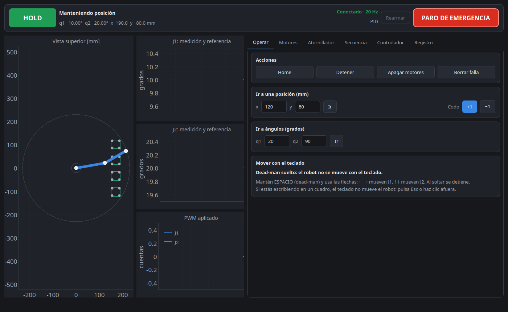
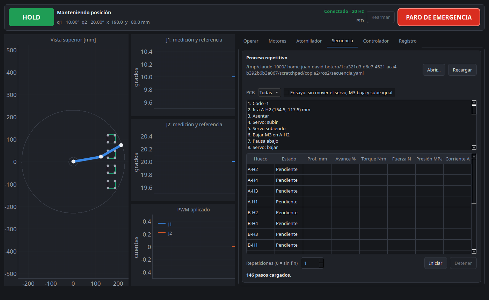
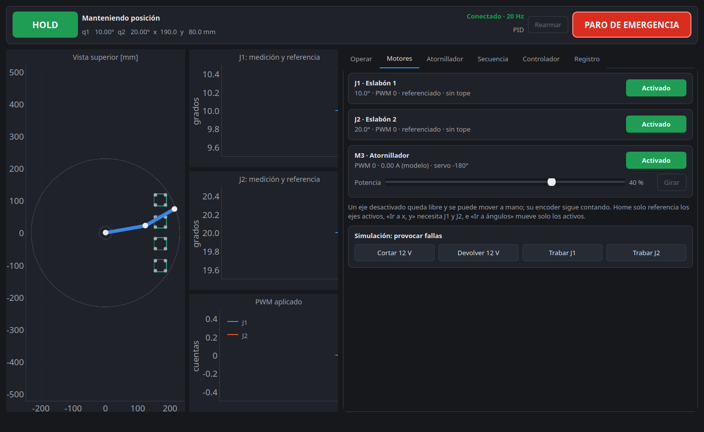
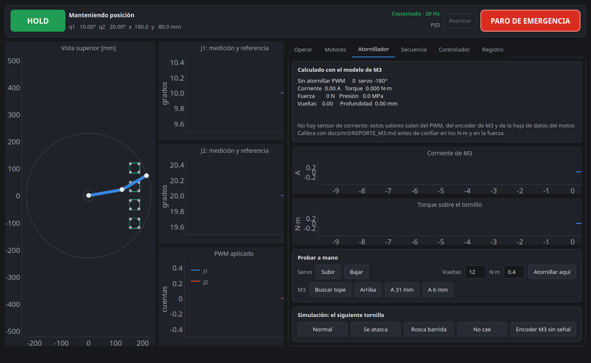
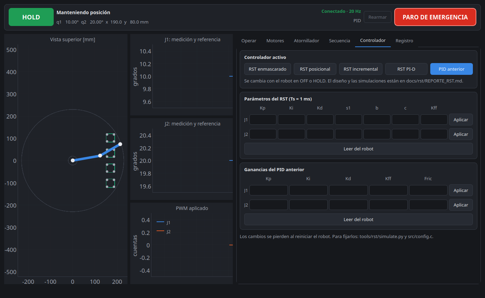
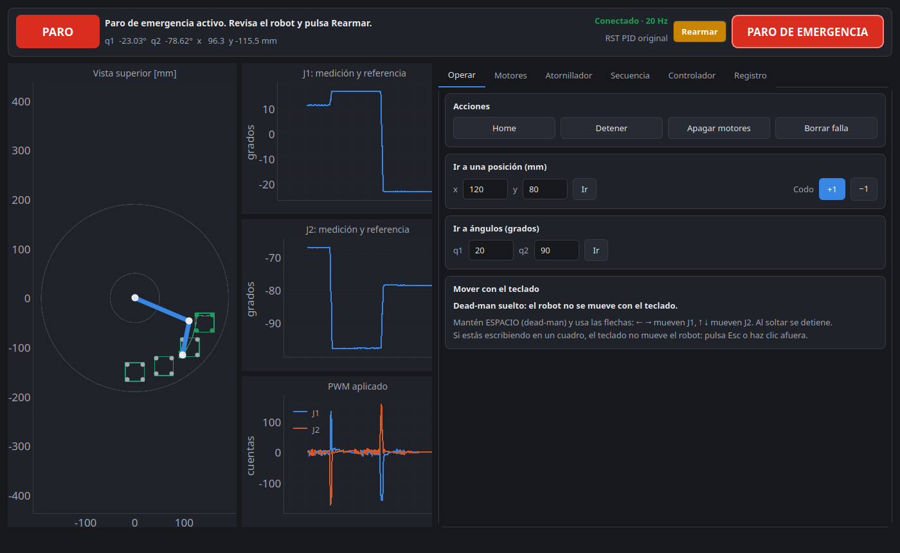

# Manual de uso del robot SCARA

Robot SCARA de dos eslabones (125 mm y 105 mm hasta la punta) con ESP32, controlado desde un PC con Ubuntu y ROS 2. Un motor (M3) sube y baja la herramienta, y un servo deja bajar cada tornillo y baja el destornillador. **Por ahora no atornilla: la punta no gira.**

## Antes de empezar: seguridad

- **Ten siempre a mano el paro físico.** Es el botón en serie con los 12 V de motores (bornera J15) y es el único que funciona aunque falle el PC o el ESP32.
- El botón **PARO DE EMERGENCIA** del panel (o la tecla **E**) depende de la comunicación. Úsalo, pero no confíes solo en él.
- Mantén las manos fuera del alcance del brazo mientras tenga corriente.
- J15 no tiene protección contra polaridad invertida: revisa + y − antes de conectar.

## Encender el robot

Usa dos terminales.

**Terminal 1, el agente que conecta el ESP32 con ROS 2:**

```bash
docker run -it --rm -v /dev:/dev --privileged --net=host \
    microros/micro-ros-agent:jazzy serial --dev /dev/ttyUSB0 -b 460800 -v6
```

Pulsa el botón EN del ESP32. El agente debe mostrar que se creó una sesión.

**Terminal 2, el panel y el gemelo digital:**

```bash
source /opt/ros/jazzy/setup.bash
cd scara_fw
ros2 launch ros2/scara_rviz.launch.py &     # gemelo digital en RViz
python3 ros2/scara_panel.py                 # panel de control
```

El encabezado del panel debe decir **Conectado · 20 Hz**. Si dice **SIN DATOS DEL ROBOT**, revisa el agente y el cable USB.

**Para practicar sin robot:** `python3 ros2/scara_panel.py --sim` arranca el simulador, RViz y el panel.

## El panel



- **Arriba:** estado del robot, posición, controlador activo y paro de emergencia, siempre visibles.
- **Izquierda:** vista superior del brazo y gráficas de medición, referencia y PWM.
- **Derecha:** pestañas Operar, Motores, Atornillador, Secuencia, Controlador y Registro.

| Estado | Qué significa |
|---|---|
| OFF | Motores apagados |
| HOMING | Buscando la referencia |
| HOLD | Manteniendo la posición |
| MOVE | Moviéndose a un punto |
| JOG | Moviéndose con el teclado |
| FALLA | Se detuvo por una falla. Hay que rearmar y repetir Home |
| PARO | Paro de emergencia activo. Hay que rearmar |

## Paso a paso

### 1. Hacer Home

Antes del Home, pulsa **Buscar tope** de M3 en la pestaña Atornillador, para que la herramienta quede arriba.

Pulsa **Home** (tecla H) en la pestaña Operar. Cada eje va a sus dos finales de carrera y el brazo termina en `0 0`, recto. Sin Home el robot no acepta órdenes de posición.

### 2. Mover a mano

Con el foco fuera de los cuadros de texto, mantén **ESPACIO** (dead-man) y usa las flechas:

| Tecla | Movimiento |
|---|---|
| ← → | J1 |
| ↑ ↓ | J2 |

Al soltar ESPACIO se detiene. Si estás escribiendo en un cuadro, el teclado no mueve el robot: pulsa Esc o haz clic afuera.

### 3. Ir a un punto

- **Ir a una posición:** escribe x, y en milímetros y pulsa **Ir**. También puedes hacer clic en la vista superior para llenar los cuadros; el clic no mueve el robot.
- **Ir a ángulos:** escribe q1, q2 en grados y pulsa **Ir**.
- **Codo:** elige cuál de las dos posturas prefieres para llegar a un punto.

### 4. Ejecutar el proceso repetitivo



`ros2/secuencia.yaml` ya trae la secuencia: 4 PCB de 38 × 38 mm, con 4 huecos cada una, 16 en total. Van en una fila recta frente al robot, con 30 mm entre ellas. Medidas al centro de cada placa, desde el eje de J1; +x es el brazo recto y +y es la izquierda:

| PCB | x (mm) | y (mm) |
|---|---|---|
| 1 (A) | 170 | 102 |
| 2 (B) | 170 | 34 |
| 3 (C) | 170 | -34 |
| 4 (D) | 170 | -102 |

1. En la pestaña **Atornillador**, pulsa **Buscar tope** de M3.
2. Haz **Home**.
3. Carga los tornillos en el dispensador.
4. En la pestaña **Secuencia**, elige la **PCB** (una o todas) y las repeticiones (0 = hasta que la detengas).
5. Pulsa **Iniciar**.

En cada hueco, el robot:

1. Mueve el brazo al hueco en línea recta y espera a que se asiente.
2. Sube el servo a +180° para que baje el tornillo.
3. Baja M3 hasta 6 mm de altura.
4. Baja el servo a -180° para que baje el destornillador.
5. Sube M3 solo 1/4 de la barra, hasta 31 mm, y marca el hueco como `hecho`.

El servo solo hace la subida y la bajada completas, sin parar en el medio. Entre huecos, se queda abajo mientras el brazo se mueve.

Al terminar, el brazo vuelve a `0 0`. Si hay una falla, el robot rechaza un punto o M3 se traba, la secuencia aborta y te dice por qué. Después apaga M3 y, si el servo estaba en +180°, baja el destornillador. Si M3 quedó abajo, el panel te avisa: **súbelo con Arriba antes de mover el brazo**. El brazo no se mueve con M3 por debajo de unos 29 mm.

**Nada detecta si un tornillo no cayó.** Tampoco se aprieta: la punta no gira.

Si cambias el archivo, pulsa **Recargar**. Si el brazo no alcanza un hueco, el panel te dice cuál. Esto se ajusta en la sección `proceso`:

```yaml
proceso:
  base_cm: [0, 0]
  codo: -1
  placas_cm: {A: [17, 10.2], B: [17, 3.4], C: [17, -3.4], D: [17, -10.2]}
  lado_mm: 38
  hueco_borde_mm: 3.5
  servo: {arriba_s: 1.0, bajar_s: 1.0}
  m3: {abajo_vueltas: 24.855, trabajo_vueltas: 18.641}   # vueltas desde el tope de arriba
```

**Ensayo.** Marca **Ensayo** en la pestaña Secuencia para recorrer los mismos huecos **sin mover el servo**. M3 baja y sube igual, hasta 6 mm: revisa que la punta no toque nada. También se puede elegir una sola PCB.

También se puede escribir una lista de pasos, sin la sección `proceso`:

```yaml
repeticiones: 3
pasos:
  - ir: [150, 40]                            # x, y en mm
  - angulos: [20, 90]                        # q1, q2 en grados
  - esperar: 0.5                             # segundos
  - codo: -1
  - servo: {accion: subir, tiempo: 0.4}      # subir, bajar o grados (-180 a 180)
  - m3_ir: 18.6                              # M3 a esas vueltas desde su tope de arriba
  - atornillar: {vueltas: 12, torque: 0.4}
  - m3: {potencia: 40, tiempo: 1.5}          # motor 3 sin control: % y segundos
```

### 5. Activar o desactivar motores



En la pestaña **Motores** hay un interruptor por motor. El botón muestra lo que el robot confirma, no solo lo que pediste.

| Con un eje desactivado | Qué pasa |
|---|---|
| Driver | Libre: se puede mover a mano |
| Encoder | Sigue contando; no pierde la referencia |
| Home | Solo referencia los ejes activos |
| Ir a una posición | Se rechaza: necesita J1 y J2 |
| Ir a ángulos | Mueve solo los ejes activos |
| Al reactivar | Se queda en la posición donde esté |

**M3 (atornillador)** arranca desactivado. Actívalo, elige la potencia y pulsa **Girar**. Si el panel deja de comunicarse, M3 se apaga solo a los 10 s. Un atornillado en curso se detiene solo cuando termina o a los 20 s. Si desactivas M3 durante un atornillado, este se cancela.

### 6. Probar el atornillador



En la pestaña **Atornillador** puedes mover el servo (**Subir**, **Bajar**) y M3:

| Botón de M3 | Qué hace |
|---|---|
| **Buscar tope** | Sube hasta el tope físico y pone ahí el cero. Hay que repetirlo cada vez que se reinicia el ESP32 |
| **Arriba** | 106 mm |
| **A 31 mm** | La altura entre huecos |
| **A 6 mm** | La altura de atornillar. Revisa antes que no toque nada |

**Atornillar aquí** es del diseño anterior, en el que M3 hacía girar la punta. **No lo uses**: M3 solo sube y baja, así que el torque que muestra esta pestaña no significa nada.

**Conexión del servo (J13).** Pin 1: +5 V, cable rojo. Pin 2: señal, cable naranja. Pin 3: GND, cable marrón. En la placa, cambia R40 por 330 Ω, retira C14, deja R41 y pon 470 µF / 16 V entre los pines 1 (+) y 3 (-). El servo arranca abajo, en -180 grados, y al encender los 12 V puede moverse hasta esa posición. Con +180 grados baja el tornillo y con -180 grados baja el destornillador; los dos están medidos en el robot.

No hay sensor de corriente: corriente, torque, fuerza y presión salen del modelo del motor, del PWM y del encoder de M3. Durante el arranque, torque, fuerza y presión se muestran en 0 porque el motor está acelerando. **Son estimaciones hasta que calibres el modelo** con `docs/m3/REPORTE_M3.md`. La profundidad sale del encoder.

| Resultado | Qué significa | Qué hacer |
|---|---|---|
| `ok` | Dio las vueltas y llegó al torque | Sigue |
| `sin_apriete` | Dio todas las vueltas sin llegar al torque | Revisa si cayó el tornillo o si la rosca está barrida |
| `trabado` | Se detuvo antes de tiempo | Revisa si el tornillo entró torcido y el cable del encoder (J8) |
| `flojo` | El motor se quedó quieto antes de llegar al torque | Revisa M3 y los 12 V, y calibra el modelo |
| `tiempo` | No terminó en 20 s | Revisa la mecánica de M3 |
| `sobrecorriente` | Pasó de 2,4 A | Revisa M3 antes de repetir |
| `cancelado` | Lo detuviste o hubo un paro | Revisa el tornillo: quedó a medias |

### 7. Elegir el controlador



El robot arranca con el **PID anterior**. En la pestaña **Controlador** se puede cambiar:

| Botón | Qué es | En el robot |
|---|---|---|
| **PID anterior** | El PID del firmware, con sus reglas de fricción | Hizo el Home y el regreso a `0 0` |
| **RST enmascarado** | Recibe valores de un PID y por dentro ejecuta un RST | Fue el que mejor siguió la consigna, en movimientos sueltos |
| **RST posicional** | Diseñado por polos; la consigna entra en P, I y D | Movimientos sueltos, con un salto tardío de hasta 1,5° |
| **RST incremental** | Diseñado por polos; la consigna entra solo por I | Hizo la PCB A completa. Se atrasa hasta 5,4° mientras se mueve |
| **RST PI-D** | Diseñado por polos; la consigna entra en P e I, no en D | No se ha movido con él |

**Cambia de controlador con el robot en OFF.** También se acepta en HOLD, pero si hay un error pequeño, el brazo puede saltar: en una prueba, J1 saltó 6,1° sin ninguna orden de movimiento. Pulsa **Apagar motores** (tecla O), elige el controlador y da la siguiente orden.

Ahí mismo se pueden ajustar los parámetros en vivo; se pierden al reiniciar. En el RST enmascarado, los valores están ya convertidos: Kd y Kff no son los del PID, y además usa Kp 5000 y Ki 3000, no los del PID anterior (6000 y 6000).

El firmware y el panel deben ser de la misma versión. Con un firmware anterior, **RST enmascarado** activaría la forma PI-D.

### 8. Apagar

Pulsa **Apagar motores** (tecla O), cierra el panel y corta los 12 V. No dejes el robot quieto en HOLD más de lo necesario: en una prueba con RST incremental, J2 llegó a 520 PWM sin moverse y sin que saliera ninguna falla.

## Cuando algo sale mal



**Paro de emergencia.** Frena, deja los motores libres, cancela el tornillo, baja el destornillador y queda enclavado. Para continuar: revisa el robot, pulsa **Rearmar** y da la orden de nuevo. La referencia se conserva, salvo que el paro interrumpa un Home. Si mantenías el dead-man, suéltalo antes de volver a mover.

**Si la secuencia se corta con el destornillador arriba.** Al detenerla o si el robot informa una falla o un error, baja solo.

**Paro físico.** Corta los 12 V de motores. El ESP32 sigue encendido y, si el brazo estaba en movimiento, declara falla porque el eje no responde.

| Mensaje | Causa probable | Qué hacer |
|---|---|---|
| Error de seguimiento | Eje trabado, encoder desconectado o signo invertido | Revisa el eje y sus cables; rearma y repite Home |
| Motor trabado | Mucho PWM y el encoder no cuenta | Revisa la mecánica y los 12 V |
| Final de carrera inesperado | Se perdió la referencia | Rearma y repite Home |
| MIN y MAX a la vez | Cableado de los finales de carrera | Revisa J9 a J12 |
| Tiempo de Home agotado | El eje no llegó al tope | Revisa el motor y el final de carrera |
| No llegó a la consigna a tiempo | Ganancias o fricción | Ajusta en la pestaña Controlador |
| SIN DATOS DEL ROBOT | Agente caído o cable USB | Revisa la terminal del agente |

## Atajos de teclado

| Tecla | Acción |
|---|---|
| ESPACIO + flechas | Mover a mano |
| E | Paro de emergencia |
| H | Home |
| S o Esc | Detener y mantener la posición |
| O | Apagar motores |
| C | Borrar falla o rearmar |
