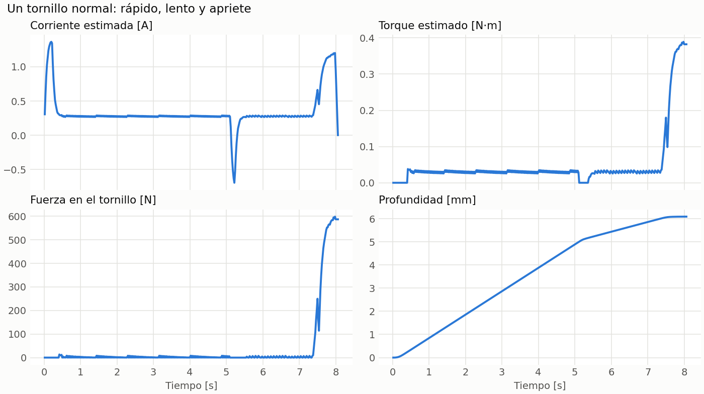
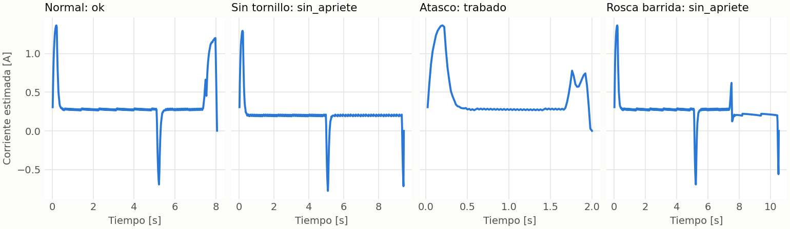

# Motor 3 y atornillado

> **Diseño anterior.** Este reporte supone que M3 hace girar la punta. Hoy M3 solo sube y baja, y la punta no gira: ver [`docs/CAMBIO_SERVO_DESTORNILLADOR.md`](../CAMBIO_SERVO_DESTORNILLADOR.md). `tools/m3/report.py`, que lo genera, tampoco se actualizó.

Generado por `python3 tools/m3/report.py`, con el firmware real contra la planta simulada. **Nada de esto se ha medido en el robot.**

## 1. Modelo del motor

Dato del usuario: M3 es de 200 rpm. Supongo un Pololu 37D 50:1 de 12 V, de la misma familia que J1 y J2, porque en esa familia 200 rpm corresponde a esa relación. **Hay que confirmarlo.**

| Dato | J1 y J2 | M3 |
|---|---|---|
| Reductor | 100:1 | 50:1 |
| Velocidad en vacío a 12 V | 100 rpm | 200 rpm |
| Corriente en vacío | 0,2 A | 0.2 A |
| Corriente calado a 12 V | 5,5 A | 5.5 A |
| Torque calado a 12 V | | 2.06 N·m (21 kg·cm) |
| Cuentas por vuelta de salida | 6424 | 3200 |

La hoja de datos extrapola los valores de calado: no los mide. Referido al eje de salida:

```
R  = 12 / I_cal                 = 2.182 ohm
Ke = (12 - R I0) / w0           = 0.5521 V/(rad/s)
Kt = T_cal / (I_cal - I0)       = 0.3886 N·m/A      (menor que Ke: pérdidas del reductor)
```

## 2. Predicción de la corriente

El ACS712 sale de J13 para dejar el sitio al servo, así que la corriente no se mide: se calcula a 1 kHz con el PWM aplicado y la velocidad del encoder de M3. Lo que el tornillo opone se nota porque frena el motor.

```
V      = PWM * 12 / 1023
i      = (V - Ke w) / R
torque = Kt (i - I0)
fuerza = (torque - T_rosca) / (K d)      K = 0,2; d = 3 mm; T_rosca = 0,03 N·m
presión = fuerza / A                     A = 15,7 mm², bajo una cabeza de 5,5 mm con hueco de 3,2 mm
profundidad = vueltas * paso             paso = 0,5 mm
```

K, el área, el paso y T_rosca son valores típicos de un tornillo M3 de acero, **no datos de tu tornillo**. K cambia con la lubricación y el material, así que la fuerza es la cifra menos segura. Este modelo no incluye la inductancia del motor.

**Límite de esta prueba:** la planta simulada usa las mismas ecuaciones que el modelo, sin inductancia. Que coincidan muestra que el firmware calcula bien, no que el modelo describa tu motor. Solo una medición en el robot puede confirmarlo.

## 3. Un tornillo

El PWM rápido es 650, el tope de PWM del firmware original. Al asentar la cabeza, el PWM baja al valor cuyo torque de calado es la meta: así el motor no puede pasarse aunque siga empujando.

Cómo leer las gráficas:

- **Primeros 0,4 s:** la corriente sube porque el motor acelera. Por eso torque, fuerza y presión se muestran en 0 durante ese tiempo.
- **Hacia los 5 s:** el PWM baja de 650 a 300 y la corriente estimada se vuelve negativa, porque el motor aún gira más rápido de lo que pide el nuevo voltaje. No es un error del tornillo.



| Resultado | Vueltas | Profundidad | Avance | Torque | Fuerza | Presión | Corriente | Tiempo |
|---|---|---|---|---|---|---|---|---|
| ok | 12.18 | 6.09 mm | 101 % | 0.382 N·m | 587 N | 37.4 MPa | 1.18 A | 8.0 s |

En la planta simulada, al terminar, el torque real es de 0.391 N·m. Mientras gira en la fase rápida, la corriente estimada se aparta de la real en 0.012 A como máximo, 4.4 %.

## 4. Tornillos que salen mal



| Caso | Qué pasa | Resultado del firmware | Vueltas | Torque |
|---|---|---|---|---|
| Normal | Asienta a las 12 vueltas | `ok` | 12.18 | 0.382 N·m |
| Sin tornillo | El servo no soltó nada | `sin_apriete` | 14.00 | 0.000 N·m |
| Atasco | Se traba a las 3 vueltas | `trabado` | 3.21 | 0.241 N·m |
| Rosca barrida | Se barre a 0,25 N·m | `sin_apriete` | 14.00 | 0.007 N·m |

Si el resultado no es `ok`, la secuencia aborta y no pasa al siguiente hueco. Sin señal del encoder, el modelo ve el motor quieto y el firmware informa `trabado` antes de 1 s: nunca da por bueno un tornillo. El mismo resultado aparece con un atasco real, así que primero revisa el cable de J8. En ese caso el torque y la fuerza del informe no valen, porque el modelo cree que el motor está calado.

## 5. Cuánto se equivoca si el motor no es igual a la hoja de datos

El firmware sigue usando los valores de la sección 1; solo cambia el motor simulado.

| Motor real | Resultado | Torque estimado | Torque real | Error |
|---|---|---|---|---|
| Igual a la hoja de datos | `ok` | 0.382 N·m | 0.391 N·m | -2 % |
| R +20 % | `ok` | 0.388 N·m | 0.325 N·m | +19 % |
| R −20 % | `ok` | 0.389 N·m | 0.506 N·m | -23 % |
| Ke +10 % | `ok` | 0.382 N·m | 0.389 N·m | -2 % |
| Ke −10 % | `ok` | 0.390 N·m | 0.404 N·m | -3 % |
| Kt +20 % | `ok` | 0.383 N·m | 0.467 N·m | -18 % |
| Kt −20 % | `ok` | 0.395 N·m | 0.333 N·m | +19 % |

Por eso los N·m son una estimación hasta calibrar. La profundidad no tiene este problema: sale del encoder, sin usar el modelo. Para calibrar:

1. **R:** con M3 sin conectar a la placa y el eje frenado, mide la resistencia con un multímetro en varias posiciones del eje.
2. **Ke:** gira M3 en vacío con `tool 50`, lee la velocidad y calcula `Ke = (V - R I0) / w`.
3. **Kt:** mide el torque con una llave dinamométrica o un peso en un brazo conocido.
4. Cambia `M3_MODEL` en `src/config.c`.

## 6. Proceso completo

Secuencia: `ros2/secuencia.yaml`. Base del brazo en (15; 0) cm, placas de 38 mm sin girar, con centro en A, B, C y D, y huecos a 3,5 mm de cada borde.

> El origen pedido está a 200.1 mm de la base y el brazo alcanza 190: se usa (-4.7, -187.9) mm, en la misma dirección.

| Hueco | x [mm] | y [mm] | Error al soltar [mm] | Resultado | Profundidad [mm] | Torque [N·m] | Fuerza [N] | Corriente [A] |
|---|---|---|---|---|---|---|---|---|
| A-H1 | 125.9 | -65.5 | 0.33 | `ok` | 6.09 | 0.382 | 587 | 1.18 |
| A-H3 | 156.9 | -65.5 | 0.17 | `ok` | 6.09 | 0.382 | 587 | 1.18 |
| A-H4 | 156.9 | -34.5 | 0.18 | `ok` | 6.09 | 0.382 | 587 | 1.18 |
| A-H2 | 125.9 | -34.5 | 0.18 | `ok` | 6.09 | 0.382 | 587 | 1.18 |
| B-H1 | 96.3 | -115.5 | 0.06 | `ok` | 6.09 | 0.382 | 587 | 1.18 |
| B-H3 | 127.3 | -115.5 | 0.31 | `ok` | 6.09 | 0.382 | 587 | 1.18 |
| B-H4 | 127.3 | -84.5 | 0.24 | `ok` | 6.09 | 0.382 | 587 | 1.18 |
| B-H2 | 96.3 | -84.5 | 0.15 | `ok` | 6.09 | 0.382 | 587 | 1.18 |
| C-H1 | 43.3 | -153.5 | 0.09 | `ok` | 6.09 | 0.382 | 587 | 1.18 |
| C-H3 | 74.3 | -153.5 | 0.06 | `ok` | 6.09 | 0.382 | 587 | 1.18 |
| C-H4 | 74.3 | -122.5 | 0.19 | `ok` | 6.09 | 0.382 | 587 | 1.18 |
| C-H2 | 43.3 | -122.5 | 0.04 | `ok` | 6.09 | 0.382 | 587 | 1.18 |
| D-H1 | -15.5 | -165.5 | 0.13 | `ok` | 6.09 | 0.382 | 587 | 1.18 |
| D-H3 | 15.5 | -165.5 | 0.10 | `ok` | 6.09 | 0.382 | 587 | 1.18 |
| D-H4 | 15.5 | -134.5 | 0.13 | `ok` | 6.09 | 0.382 | 587 | 1.18 |
| D-H2 | -15.5 | -134.5 | 0.11 | `ok` | 6.09 | 0.382 | 587 | 1.18 |

Estado final: **done**. Duración simulada del ciclo: 171 s. Error máximo de posición al soltar: 0.33 mm. La simulación no incluye juego mecánico ni error de montaje. Suponiendo un hueco de 3,2 mm y un tornillo de 3 mm, la holgura es de 0,1 mm por lado, menor que ese error: hará falta una punta o un chaflán que guíe el tornillo. **Revísalo en el robot.**

## 7. Lo que falta medir o confirmar

- Modelo y relación de M3, y sus valores R, Ke y Kt.
- Tornillo real: paso, largo, material y torque de apriete. Valores actuales: 12 vueltas, 0,4 N·m.
- Que al bajar M3 la punta gire en el sentido de apretar (`TOOL_MOTOR_SIGN` y `TOOL_ENC_SIGN` ya bajan M3 con PWM positivo), y cuentas por vuelta (`TOOL_ENC_CUENTAS`).
- Ángulo de subida del servo (`SERVO_ARRIBA_DEG`). Arranca abajo, en -180 grados (`SERVO_ABAJO_DEG`).
- **Señal del servo:** en la placa, cambia R40 por 330 Ω y retira C14. R41 se queda.
- **Alimentación del servo:** el MG90S puede pedir unos 700 mA calado, de los mismos 5 V del LM2596 que alimentan encoders y lógica. Pon 470 µF entre los pines 1 (+) y 3 (-) de J13 y comprueba que el ESP32 no se reinicie cuando el servo se mueve.
- **Altura:** el brazo no tiene eje z. Comprueba que la punta pase sobre las placas sin chocar en los traslados, y que M3 baje con el tornillo mientras este entra (6 mm). Después M3 sube por tiempo girando al revés (`subir_pct` y `subir_s` en `ros2/secuencia.yaml`): se supone que la punta se suelta sola del tornillo, sin medirlo.
- Posición de los huecos: se midió en la imagen, con unos ±0,1 mm.
- Origen: (14,5; −20) cm queda fuera de alcance por 1 cm. Si en el robot real debe llegar ahí, hay que mover la base o alargar el brazo.
