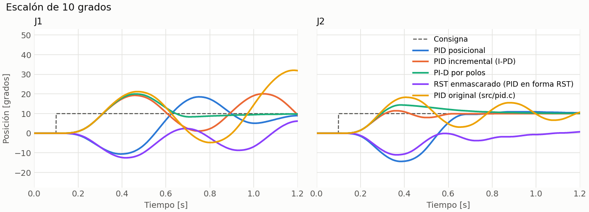
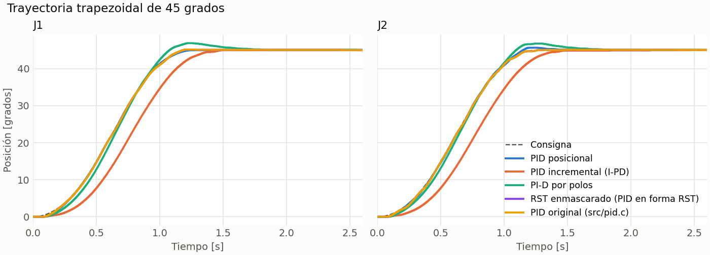
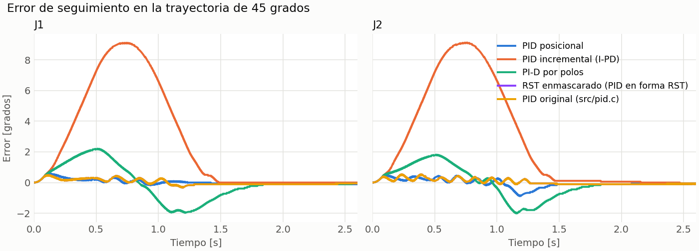
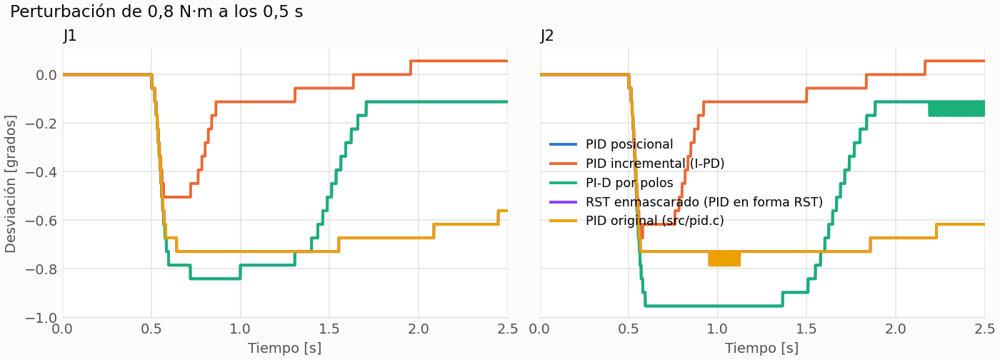

# Controladores RST del SCARA

Generado por `python3 tools/rst/simulate.py`. Todos los números salen de ese programa.

**Forma elegida para el robot: RST enmascarado (PID en forma RST).** Este reporte es solo simulación y usa parámetros anteriores a la calibración actual. La prueba en el robot está resumida en el README.

## 1. Planta

Cada articulación se modela como motor con reductor, de PWM a posición:

```
q(s)/V(s) = K / (s (tau s + 1)),   V = u * 12 / 1023
```

| Dato | Valor | Origen |
|---|---|---|
| K | 0.9974 rad/s por V | Identificado en el laboratorio de Control Digital, sin eslabón |
| tau J1 | 0.14 s | Estimado: motor + eslabones. **Sin medir** |
| tau J2 | 0.10 s | Estimado: motor + eslabón 2. **Sin medir** |
| Ts | 1 ms | El mismo lazo del PID original. Es lo que permite reproducir su PWM (sección 6) |

La planta de las simulaciones usa otro juego de datos a propósito: el motor de la hoja de datos (K = 0.887 rad/s por V), con fricción seca, encoder cuantizado, saturación y rampa de PWM. El controlador no se prueba contra el mismo modelo con el que se diseñó.

Discretización ZOH:

```
A(q^-1) = (1 - q^-1)(1 - a q^-1),  a = exp(-Ts/tau)
B(q^-1) = b1 q^-1 + b2 q^-2
```

| Eje | A | B |
|---|---|---|
| J1 | `[1.0000, -1.9929, 0.9929]` | `[0, 4.1685e-08, 4.1586e-08]` |
| J2 | `[1.0000, -1.9900, 0.9900]` | `[0, 5.8304e-08, 5.8110e-08]` |

## 2. Estructura RST

```
S(q^-1) u(k) = T(q^-1) r(k) - R(q^-1) y(k)
S = (1 - q^-1)(1 + s1 q^-1)
R = Kp (1 - q^-1)(1 + s1 q^-1) + Ki Ts (1 + s1 q^-1) + (Kd/Ts)(1 - q^-1)^2
T = b Kp (1 - q^-1)(1 + s1 q^-1) + Ki Ts (1 + s1 q^-1) + c (Kd/Ts)(1 - q^-1)^2 + (Kff/Ts) S (1 - q^-1)
```

El último término de T es la prealimentación de velocidad (Kff = 1/K en PWM, 85.5 PWM por rad/s). Sin ella, toda la velocidad de crucero la sostiene el integrador, y al frenar en seco el brazo se pasa mientras se descarga. Como S(1) = 0, no cambia la ganancia estática; como está en T, tampoco los polos.

R y S salen de la ecuación diofántica `A S + B R = P`, con P dado por los polos deseados. T no mueve los polos: decide cómo entra la consigna, con los pesos b y c. En los tres casos `T(1) = R(1)`, así que la ganancia estática es 1.

| Forma | b | c | Ley equivalente |
|---|---|---|---|
| PID posicional | 1 | 1 | P, I y D actúan sobre el error |
| PID incremental (I-PD) | 0 | 0 | Solo I actúa sobre el error; P y D sobre la medición |
| PI-D por polos | 1 | 0 | La consigna queda fuera del término D |
| RST enmascarado (PID en forma RST) | 1 | 0 | Se ingresan valores de un PID y corre un RST con los polinomios equivalentes |

> **Por confirmar con el profesor:** el equipo definió el RST enmascarado como el que recibe valores de un PID y por dentro ejecuta un RST. Si la definición es otra, se cambia `FORMS` en `rst_design.py` y se vuelve a generar este reporte.

**Convención:** este reporte usa la de Landau. Algunos libros intercambian los nombres de R y S.

## 3. Diseños

| Eje | Forma | Polos: wn, zeta, auxiliares | Kp | Ki | Kd | s1 | Kff | max |polo| con K ±20 %, tau ±50 % |
|---|---|---|---|---|---|---|---|---|
| J1 | PID posicional | 12 rad/s, 0.9, (8.0, 60.0) rad/s | 2779 | 9939 | 14.65 | -0.9201 | 85.5 | 0.99557 |
| J1 | PID incremental (I-PD) | 15 rad/s, 0.9, (40.0, 60.0) rad/s | 8120 | 52907 | 43.02 | -0.8849 | 85.5 | 0.99255 |
| J1 | PI-D por polos | 12 rad/s, 0.9, (8.0, 60.0) rad/s | 2779 | 9939 | 14.65 | -0.9201 | 85.5 | 0.99557 |
| J1 | RST enmascarado (PID en forma RST) | Resultan de los valores del PID | 5000 | 3000 | 16.36 | -0.9091 | 260.0 | 0.99938 |
| J2 | PID posicional | 12 rad/s, 0.9, (8.0, 60.0) rad/s | 2055 | 7361 | 8.70 | -0.9229 | 85.5 | 0.99534 |
| J2 | PID incremental (I-PD) | 15 rad/s, 0.9, (40.0, 60.0) rad/s | 5939 | 38748 | 28.07 | -0.8876 | 85.5 | 0.99228 |
| J2 | PI-D por polos | 12 rad/s, 0.9, (8.0, 60.0) rad/s | 2055 | 7361 | 8.70 | -0.9229 | 85.5 | 0.99534 |
| J2 | RST enmascarado (PID en forma RST) | Resultan de los valores del PID | 5000 | 3000 | 16.36 | -0.9091 | 260.0 | 0.99938 |

Las tres primeras formas salen de la asignación de polos. La incremental lleva polos más rápidos a propósito: su error en rampa es Kp/Ki por la velocidad, y con los polos de las otras dos pasaría el límite de falla del firmware en un movimiento normal.

La cuarta no se diseñó con polos: es `src/pid.c` escrito como RST, con `s1 = -tau_v/(tau_v + Ts)`, `Kd_RST = Kd (1 + s1)` y `Kff_RST = Kff + Kd`, donde tau_v = 10 ms es el filtro de velocidad del firmware. Sus polos nominales de J1 son 0.92766, 0.98719, 0.98719, 0.99938.

Todos los valores de la última columna deben ser menores que 1 para que el lazo siga estable.

Coeficientes (potencias crecientes de q^-1):

| Eje | Forma | R | S | T |
|---|---|---|---|---|
| J1 | PID posicional | `[17441.7927, -34650.8594, 17209.8606]` | `[1.0000, -1.9201, 0.9201]` | `[102914.0205, -284240.8827, 259973.2237, -78645.5677]` |
| J1 | PID incremental (I-PD) | `[51189.1423, -101384.9938, 50201.9387]` | `[1.0000, -1.8849, 0.8849]` | `[85525.1345, -246629.4508, 236748.5791, -75638.1757]` |
| J1 | PI-D por polos | `[17441.7927, -34650.8594, 17209.8606]` | `[1.0000, -1.9201, 0.9201]` | `[88261.6019, -254936.0455, 245320.8051, -78645.5677]` |
| J1 | RST enmascarado (PID en forma RST) | `[21366.6364, -42275.4545, 20909.0909]` | `[1.0000, -1.9091, 0.9091]` | `[90475.2278, -258194.6627, 245421.7329, -77702.0253]` |
| J2 | PID posicional | `[10766.2860, -21366.1021, 10600.3839]` | `[1.0000, -1.9229, 0.9229]` | `[96238.5138, -271189.7559, 253831.0081, -78879.1982]` |
| J2 | PID incremental (I-PD) | `[34045.3985, -67380.2919, 33339.2475]` | `[1.0000, -1.8876, 0.8876]` | `[85510.9761, -246846.4247, 237207.3778, -75867.5750]` |
| J2 | PI-D por polos | `[10766.2860, -21366.1021, 10600.3839]` | `[1.0000, -1.9229, 0.9229]` | `[87534.9182, -253782.5647, 245127.4125, -78879.1982]` |
| J2 | RST enmascarado (PID en forma RST) | `[21366.6364, -42275.4545, 20909.0909]` | `[1.0000, -1.9091, 0.9091]` | `[90475.2278, -258194.6627, 245421.7329, -77702.0253]` |

Ecuación que ejecuta el firmware (`src/rst.c`), cada 1 ms:

```
u(k) = t0 r(k) + t1 r(k-1) + t2 r(k-2) + t3 r(k-3) - r0 y(k) - r1 y(k-1) - r2 y(k-2) + (1 - s1) u(k-1) + s1 u(k-2)
```

La historia guarda el PWM ya saturado: así el integrador no se enrolla. La rampa de PWM se aplica afuera; dentro de la historia borraría el término proporcional. La compensación de fricción seca (70 PWM) se suma afuera con la misma regla de `pid.c`: sentido de u y solo si el error supera 0,15 grados.

## 4. Respuesta de posición

### Escalón de 10 grados

Sin prealimentación: es la respuesta del RST por sí solo, donde más se nota la diferencia entre formas. En el robot las consignas nunca son escalones, siempre pasan por la trayectoria.



El PID anterior no está pensado para escalones: el firmware siempre le da una trayectoria. Con el escalón, la rampa de PWM desestabiliza su lazo, sobre todo en J1. Ese resultado no aplica al uso normal.

| Eje | Controlador | Sobreimpulso [grados] | Asentamiento ±0.4 grados [s] | PWM máximo | Error final [grados] |
|---|---|---|---|---|---|
| J1 | PID posicional | 8.55 | 1.19 | 505 | 0.031 |
| J1 | PID incremental (I-PD) | 11.18 | 2.40 | 461 | 7.366 |
| J1 | PI-D por polos | 10.01 | 0.95 | 432 | 0.025 |
| J1 | RST enmascarado (PID en forma RST) | 0.76 | 2.40 | 401 | 11.737 |
| J1 | PID original (src/pid.c) | 39.37 | 2.40 | 650 | 26.756 |
| J2 | PID posicional | 0.93 | 1.10 | 436 | 0.087 |
| J2 | PID incremental (I-PD) | 1.43 | 0.49 | 324 | 0.031 |
| J2 | PI-D por polos | 4.40 | 0.83 | 356 | 0.087 |
| J2 | RST enmascarado (PID en forma RST) | 0.00 | 2.40 | 327 | 4.228 |
| J2 | PID original (src/pid.c) | 8.33 | 1.21 | 390 | 0.087 |

### Trayectoria trapezoidal de 45 grados (el caso real del robot)



| Eje | Controlador | Error de seguimiento máx. [grados] | Sobreimpulso [grados] | Asentamiento [s] | PWM máximo | Error final [grados] |
|---|---|---|---|---|---|---|
| J1 | PID posicional | 0.57 | 0.11 | 0.00 | 216 | 0.112 |
| J1 | PID incremental (I-PD) | 9.12 | 0.00 | 0.17 | 181 | 0.000 |
| J1 | PI-D por polos | 2.21 | 1.91 | 0.39 | 195 | 0.056 |
| J1 | RST enmascarado (PID en forma RST) | 0.49 | 0.17 | 0.00 | 214 | 0.056 |
| J1 | PID original (src/pid.c) | 0.49 | 0.17 | 0.00 | 214 | 0.056 |
| J2 | PID posicional | 0.89 | 0.67 | 0.07 | 213 | 0.056 |
| J2 | PID incremental (I-PD) | 9.13 | 0.06 | 0.17 | 174 | 0.056 |
| J2 | PI-D por polos | 2.01 | 1.79 | 0.39 | 179 | 0.056 |
| J2 | RST enmascarado (PID en forma RST) | 0.54 | 0.11 | 0.00 | 217 | 0.056 |
| J2 | PID original (src/pid.c) | 0.54 | 0.11 | 0.00 | 217 | 0.056 |



### Perturbación de 0.8 N·m en el eje de salida



| Eje | Controlador | Desviación máxima [grados] | Recuperación ±0.4 grados [s] |
|---|---|---|---|
| J1 | PID posicional | 0.84 | 1.04 |
| J1 | PID incremental (I-PD) | 0.50 | 0.26 |
| J1 | PI-D por polos | 0.84 | 1.04 |
| J1 | RST enmascarado (PID en forma RST) | 0.73 | 2.00 |
| J1 | PID original (src/pid.c) | 0.73 | 2.00 |
| J2 | PID posicional | 0.95 | 1.21 |
| J2 | PID incremental (I-PD) | 0.67 | 0.32 |
| J2 | PI-D por polos | 0.95 | 1.21 |
| J2 | RST enmascarado (PID en forma RST) | 0.78 | 2.00 |
| J2 | PID original (src/pid.c) | 0.78 | 2.00 |

## 5. Robustez

Peor caso del movimiento de 45 grados con la inercia del eslabón ×0,25, ×1 y ×2,5, y la fricción seca ×0,5, ×1 y ×1,5 (9 casos por eje).

| Eje | Forma | Error de seguimiento [grados] | Sobreimpulso [grados] | Asentamiento [s] | Error final [grados] |
|---|---|---|---|---|---|
| J1 | PID posicional | 1.74 | 0.78 | 0.66 | 0.112 |
| J1 | PID incremental (I-PD) | 9.16 | 0.28 | 0.20 | 0.056 |
| J1 | PI-D por polos | 2.84 | 2.63 | 0.51 | 0.056 |
| J1 | RST enmascarado (PID en forma RST) | 1.05 | 0.28 | 0.00 | 0.112 |
| J2 | PID posicional | 1.55 | 1.06 | 0.87 | 0.112 |
| J2 | PID incremental (I-PD) | 9.15 | 0.11 | 0.19 | 0.056 |
| J2 | PI-D por polos | 2.60 | 2.52 | 0.50 | 0.056 |
| J2 | RST enmascarado (PID en forma RST) | 0.59 | 0.17 | 0.00 | 0.112 |

## 6. Decisión

Criterio, en este orden:

1. En todos los casos de robustez, el error de seguimiento queda por debajo del 80 % del límite de falla del firmware (9.2 grados) y el error final dentro de ±0.4 grados.
2. Entre las que cumplen, gana la de PWM más parecido al del PID original, que es el que funcionó en el robot.

| Forma | Cumple el criterio 1 | Peor error de seguimiento [grados] | Diferencia de PWM frente al PID original, peor eje: rms / máxima |
|---|---|---|---|
| PID posicional | Sí | 1.74 | 37.2 / 124.1 |
| PID incremental (I-PD) | Sí | 9.16 | 40.6 / 163.2 |
| PI-D por polos | Sí | 2.84 | 40.9 / 109.8 |
| RST enmascarado (PID en forma RST) | Sí | 1.05 | 0.0 / 0.0 |

**Resultado: RST enmascarado (PID en forma RST).** Es la forma que se carga al activar el RST; el firmware arranca con PID (`src/config.h`). Las otras formas se eligen con `rstform`, y `pid.c` sigue disponible con `ctrl pid`. El segundo criterio lo pidió el dueño del robot: el PWM del firmware original funcionaba bien. Sin él, ganaría la forma de menor error de seguimiento en la tabla.

## 7. Límites de este resultado

- La inercia de los eslabones y por tanto tau son estimaciones. Medirlos en el robot y volver a correr este programa con los valores reales.
- El modelo de fricción es suave cerca de velocidad cero: no reproduce la adherencia real del reductor, que puede causar una pequeña oscilación en reposo si Ki es alto.
- Los ejes se simulan desacoplados; con reductor 100:1 el acoplamiento debe ser pequeño, pero no se midió.
- Nada de esto se ha ejecutado aún en el robot.
- La igualdad de PWM con `pid.c` deja de valer si el PWM satura o el integrador pasa de 250 PWM: `pid.c` lo limita a ese valor y el RST no tiene ese límite aparte.
